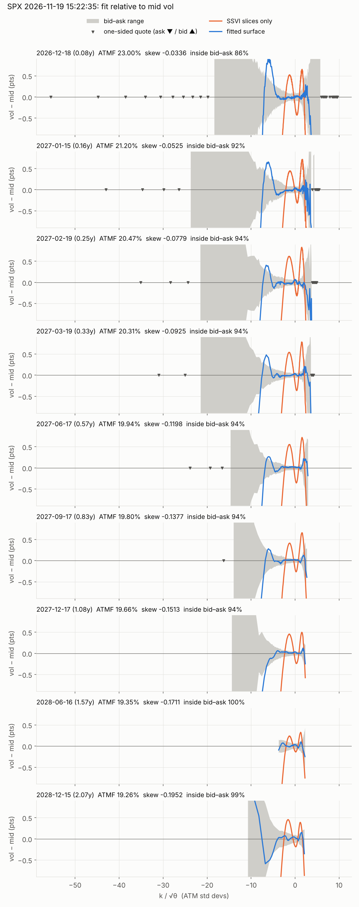

# VolFittingSVIBspline

An arbitrage-free implied-volatility surface for listed equity and index options, built as **SSVI slices × a
local-variance B-spline correction**. It is fitted to every bid–ask quote by Bayesian evidence. It is designed
for raw chains: single names with weeklies, earnings, ask-only wings and thousands of rows, as well as index
surfaces.

- **A good zeroth-order surface:** SSVI slices whose ATMF level per expiry is exact, with a smooth term
  structure.
- **A correction sized to the data:** local-variance B-splines over the quoted range, with knots at the
  expiries. As many information-ranked modes as the quotes support.
- **No static arbitrage by construction:**
  - a calendar-free baseline (exact projection, not a penalty);
  - positive local variance;
  - exact conservation of mass and forward;
  - delivered prices that are the solver's own.
- **Fitting in price space:** the likelihood is the bid–ask interval in half-spreads. Far wings, one-sided
  quotes and mids below intrinsic need no implied-vol inversion.
- **One principle for every choice:** maximize the evidence (minimize the free energy).

## The model

**Zeroth order: SSVI slices.** For each expiry Tᵢ,

  w₀(k) = ½ [ θᵢ + ρᵢψᵢk + √((ψᵢk + θᵢρᵢ)² + θᵢ²(1 − ρᵢ²)) ],  ψᵢ = η θᵢ^(1−γ) (1+θᵢ)^(γ−1),  ρᵢ = sᵢ/ψᵢ,

so that w₀(0) = θᵢ (ATMF total variance) and ∂ₖw₀(0) = sᵢ (ATM skew). The Gatheral–Jacquier butterfly
conditions and Lee's wing bound are enforced.

*No calendar arbitrage.* The baseline satisfies the eSSVI conditions (Hendriks–Martini) at every maturity:
- θ is non-decreasing;
- both wing slopes ψ ± s are non-decreasing;
- φ = ψ/θ is non-increasing.

Rising wing slopes alone are not enough: about 10% of random slice pairs that satisfy them still cross. With φ
non-increasing as well, none of 63,705 did. The fit keeps the parameters feasible with a penalty and then
projects them exactly onto the feasible set.

*Between expiries:*
- θ(T) is a monotone PCHIP through (0, 0), extended linearly beyond the last expiry;
- ψ stays on its law;
- the skew x = 2s is a cubic Hermite in S = 2ψ with |dx/dS| ≤ 1.

So the conditions hold between expiries too, and local vol has no jumps at the expiries. The one exception is
where the data push the skew change to its limit. On the synthetic book that happens only around an earnings
date.

*Smooth term structure.* A Cauchy prior on the changes of log forward variance and of ρ between expiries smooths
noise in weekly expiries without flattening a genuine earnings jump. Its heavy tails let one interval carry
it. The prior's scale is chosen by the baseline's evidence.

**Correction: local variance.** The baseline defines a Dupire local variance v₀(k, T). The fitted surface uses

  v(k, T) = v₀(k, T) · exp ν(x, t),  ν = Σ aₘₙ Bₘ(x) Bₙ(t),  x = k/√θ(T),  t = ln T,

with cubic B-splines in x over the two-sided quotes' range (0.45 ATM standard deviations apart) and clamped
cubics in ln T with knots at the expiries. Normalized call prices solve ∂c/∂T = ½ v (c_kk − c_k). The solver
uses:
- **grid:** non-uniform in log-strike, k = A sinh ξ: about 0.001 apart at the money, wide enough for every quote
  and at least 12 standard deviations of the last expiry;
- **time steps:** as many per expiry interval as the growth of ln θ needs;
- **scheme:** Crank–Nicolson with a Rannacher start.

The solve starts near t = 0 from a butterfly-free SSVI slice, so the correction also shapes local vol before
the first expiry. That is the local vol a path-dependent pricer needs. Since v > 0, the surface has **no
calendar or butterfly arbitrage for any coefficients**. The prices handed out are the solver's own,
interpolated linearly in strike, so what passes the arbitrage checks is exactly what is delivered.

An alternative start (`start="first_slice"`) corrects the first expiry's density directly. It conserves mass
and forward exactly, but its factor 1 + Σ aₘBₘ can turn negative on steep short-dated smiles, as it did on
SPX.

**Modes.** The coefficients are a = V c:
- **constraint:** V lies in the null space of "ATMF level unchanged at every expiry". The skew is free, and
  the fitted surface's skew is an output.
- **ranking:** within that space, the generalized eigenproblem (AᵀWA) v = κ P₁ v ranks directions by data
  information against a smoothness prior P₁, with squared-exponential correlations of 1.6 sd in strike and 0.7
  in ln T.
- **how many:** every mode with κ ≥ 10⁻³ is fitted, so the count follows the data (101 on the synthetic single
  name).

Two fixed priors, not scaled by τ, keep the correction sane wherever the quotes say little:
- **amplitude:** every coefficient has sd 1.5, so local variance is never multiplied by more than about 20×;
- **wing anchor:** coefficients where no quotes are have sd 0.25.

Without them, on SPX, cent-priced deep-wing quotes let ν reach 26.

**Likelihood and evidence.** Each quote is an interval in normalized price:
- **two-sided:** [bid, ask];
- **ask-only:** [intrinsic, ask];
- **bid-only:** [bid, ∞).

The interval is blurred by Gaussian noise of 0.25 half-spreads, plus a mild pull to the mid (1/8 nat at the
edge of the spread). The prior on a is ½aᵀP₁a/τ² plus the anchor. Levenberg–Marquardt fits on the exact
surface. τ, the term-structure scale and the configuration choices are all made by the Laplace free energy.

**Relinearization.** One round projects the solution back onto the exact ATMF levels, recomputes the modes there
and refits. When the correction is large the first-order projection can cost more fit than it gains. A round
that worsens −ln L by more than 50 is then rejected, and the fit's ATMF gap is reported instead.

## Results

### Single-name stress test

[`exp/07_single_name.py`](exp/07_single_name.py) builds a synthetic listed chain with a known, arbitrage-free
truth (`volsurf.synthetic`):
- 16 expiries from 1 week to 2 years;
- an earnings jump of ±15% at 3.5 weeks, giving concave post-earnings smiles;
- dollar strikes, tick-rounded spreads, and 19% ask-only rows;
- 1,270 out-of-the-money rows in all.

It is fitted on **all rows** and scored with the metrics of an independent comparison (a VolLab report):

| | before the redesign | now |
|---|---|---|
| outcome | `LinAlgError` (thinned) / `ValueError` (all rows) after 15–17 min | completes in 12 min (one core) |
| price RMS, in half-spreads | — | 0.35 |
| two-sided quotes outside bid–ask | — | 10 of ~1,030 |
| ask-only quotes above the ask | — | 1 |
| implied-vol error against the truth | — | 0.58 vol pts RMS |
| arbitrage checks (solver and delivered prices) | — | all pass |
| local-vol move under ±0.1-spread quote shocks | — | 0.36–0.46 (supported) / 2.4–2.5 (wings) vol pts |

The crashes were divisions by Black vega, which is about 0 for far out-of-the-money quotes. The model now has
no implied-vol step in the fit.

Local vol's roughness in time is concentrated in the interval containing the earnings date. A deterministic
local-vol model must put a jump somewhere inside that interval: the week-scaled bend there is about 575, from
the baseline's ATM term structure. Six weeks or more out, it is 0–14.

Results: [`results/single_name/`](results/single_name/).

### SPX

Three Cboe snapshots (13, 17 and 19 Nov 2026), nine monthly expiries from Dec 2026 to Dec 2028, **every quote**
on them (`volsurf.config.SPX_STUDY`): about 2,750 rows per day. Each day's parameters, checks and figures are in
`results/days/<YYYYMMDD>/`.

| | 13 Nov | 17 Nov | 19 Nov |
|---|---|---|---|
| quotes | 2,750 | 2,750 | 2,768 |
| inside bid–ask | 89.5% | 91.2% | 92.3% |
| price RMS (half-spreads) | 0.91 | 0.82 | 0.90 |
| arbitrage checks | pass | pass | pass |
| ATMF gap (relinearization rejected) | 0.16 | 0.18 | 0.11 vol pts |
| minutes on one core | 17 | 16 | 11 |

The earlier revision reported 98–100% inside bid–ask, but on 36 strikes per expiry within −3.5 to +2 sd. These
fits use every quote, including deep wings priced in cents.

**Known weaknesses:**
- **Rough short-dated put wing.** On 17 and 19 Nov, local vol between −3 and −1 sd in the first months is bumpy,
  with spikes to about 85%. The evidence chooses a very weak smoothness prior (τ of 360 to 1,000) to fit
  thousands of tight-spread quotes. The surface is arbitrage-free, but it is not yet smooth enough for
  path-dependent pricing there.
- **ATMF is not exact.** The surface's ATMF vol misses the parameter θ by up to 0.18 vol points, because
  relinearization was rejected on all three days.




The other studies (`exp/02`–`06`) were run on earlier revisions and are rebuilt by `./reproduce.sh full`.

## Quick start

```bash
pip install -r requirements.txt
python data/fetch.py                        # today's Cboe SPX snapshot into data/ (see data/README.md)
PYTHONPATH=src python -m volsurf fit data/SPX_*.json --out results/mine --spx-study
```

```python
from volsurf import Config, run_day, parameters
from volsurf.config import SPX_STUDY
res = run_day("data/SPX_20261119_1522.json", SPX_STUDY)   # Config() would fit every expiry in the chain
m = res["model"]
m.calls(3, k)                  # normalized call prices C / (D F) at expiry index 3, log-moneyness k
m.iv_exact(3, k)               # the same as implied vols
m.local_vol(0.5, x)            # local vol at T = 0.5, x = k / sqrt(theta)
m.supported(0.5, x)            # where that local vol is pinned down by quotes
res["checks"]                  # coverage, price score, graded arbitrage report
```

### Your own chain

Any chain given as rows works, prices or implied vols:
- **prices:** `build_market_from_rows(rows, spot, quote_time, cfg)`, with rows of `root, ymd, cp, K, bid, ask`;
  a bid of 0 means ask-only;
- **implied vols:** `fit_vols(...)`.

Then call `run_day(market, cfg)`.

```python
from volsurf import Config, fit_vols
res = fit_vols([
    dict(T=0.0838, strike=[6000, 6100, ...], forward=6712.4, iv_bid=[...], iv_ask=[...], label="2026-12-18"),
    dict(T=0.1603, k=[-0.31, -0.29, ...], iv_bid=[...], iv_ask=[...]),   # NaN for a missing side
], Config())
```

Vol inputs follow these rules:
- vols are decimals (0.20 = 20%);
- a missing bid or ask (NaN) makes the quote one-sided;
- with mid vols only, give `half_spread`.

From a CSV with one row per strike: `python -m volsurf fit-vols vols.csv --out DIR`.

The tests are `pytest -q`, about 15 s. Everything in `results/` is rebuilt by `./reproduce.sh` (quick) or
`./reproduce.sh full`.

## Repository

| | |
|---|---|
| `src/volsurf/` | the package; modules below |
| `tests/` | unit tests and an end-to-end recovery of a known surface |
| `exp/` | the numbered studies that produce `results/` |
| `results/` | outputs for the reference snapshots and the synthetic single-name book |
| `data/` | how to get the chains (not redistributed), plus checksums |
| `AGENTS.md` | invariants and conventions for contributors |

Modules in `src/volsurf/`:

| module | contents |
|---|---|
| `market` | chain → forwards, discounts and normalized prices by put–call parity; or implied vols directly |
| `ssvi` | baseline slices, calendar projection, term-structure prior |
| `dupire` | local-variance surface and solver |
| `modes` | information-ranked modes |
| `likelihood` | price-space bid–ask likelihood |
| `fit` | baseline, Levenberg–Marquardt, free energy |
| `relinearize` | the relinearization round |
| `diagnostics` | coverage, price score, arbitrage report |
| `synthetic` | single-name books with a known truth |
| `plotting`, `pipeline` | figures; one day end to end |

## References

- J. Gatheral, A. Jacquier, *Arbitrage-free SVI volatility surfaces*, Quantitative Finance 14 (2014).
- S. Hendriks, C. Martini, *The extended SSVI volatility surface*, J. Computational Finance 22 (2019).
- J. Corbetta, P. Cohort, I. Laachir, C. Martini, *Robust calibration and arbitrage-free interpolation of SSVI
  slices*, Decisions in Economics and Finance 42 (2019).
- B. Dupire, *Pricing with a smile*, Risk 7 (1994).
- R. Lee, *The moment formula for implied volatility at extreme strikes*, Mathematical Finance 14 (2004).
- F. N. Fritsch, R. E. Carlson, *Monotone piecewise cubic interpolation*, SIAM J. Numer. Anal. 17 (1980).
- M. Avellaneda, C. Friedman, R. Holmes, D. Samperi, *Calibrating volatility surfaces via relative-entropy
  minimization*, Applied Mathematical Finance 4 (1997).
- D. MacKay, *Bayesian interpolation*, Neural Computation 4 (1992).

## License

See [LICENSE](LICENSE).
