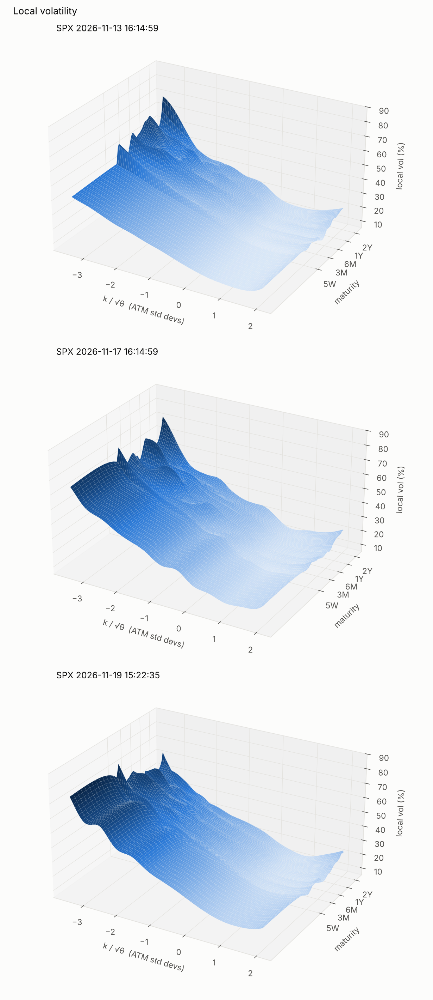

# VolFittingSVIBspline

An arbitrage-free implied-volatility surface for SPX, built as **SSVI slices × a local-variance B-spline
correction**. It is fitted to bid–ask quotes by Bayesian evidence. The design goals were:

- **A good zeroth-order surface** whose parameters are the quantities traders quote: ATMF level and ATM skew
  per expiry.
- **Few parameters**, expanded in a small basis ranked by how much the quotes say about each direction.
- **Lee's wing bounds** and **no static arbitrage** by construction: no penalty terms and no check grid.
- **One principle** for choosing everything: maximize the evidence (minimize the free energy).

## The model

**Zeroth order: SSVI slices.** For each expiry Tᵢ,

  w₀(k) = ½ [ θᵢ + ρᵢψᵢk + √((ψᵢk + θᵢρᵢ)² + θᵢ²(1 − ρᵢ²)) ],  ψᵢ = η θᵢ^(1−γ) (1+θᵢ)^(γ−1),  ρᵢ = sᵢ/ψᵢ,

so that w₀(0) = θᵢ (ATMF total variance) and ∂ₖw₀(0) = sᵢ (ATM skew) **exactly**. The wing slopes ψ(1 ± ρ)/2
stay at or below 2 (Lee). The Gatheral–Jacquier conditions are enforced as bounds. Between expiries, θ(T) is a
monotone PCHIP through (0, 0) and the skew is a PCHIP in θ. This keeps the baseline's local volatility
continuous across the expiry dates.

**Correction: local variance.** The baseline defines a Dupire local variance v₀(k, T). The fitted surface uses

  v(k, T) = v₀(k, T) · exp ν(x, t),  ν = Σ aₘₙ Bₘ(x) Bₙ(t),  x = k/√θ(T) (ATM standard deviations),  t = ln T,

with uniform cubic B-splines in x and clamped cubics in ln T. Normalized call prices come from the forward
equation ∂c/∂T = ½ v (c_kk − c_k), solved with Crank–Nicolson. The first expiry is a density correction
q₀(1 + Σ aₘBₘ) with a ≥ −1, conserving mass and the forward. Since v > 0 and the density is non-negative, the
surface has **no calendar or butterfly arbitrage for any coefficients**.

**Modes.** The coefficients are a = V c, where V holds the leading K modes. Two steps define them:

1. They lie in the null space of the linear constraints "ATMF level and ATM skew at every expiry unchanged",
   so the SSVI parameters keep their meaning.
2. Within that space, they solve the generalized eigenproblem (AᵀWA) v = κ P₁ v, with the data information
   AᵀWA ranked against a smoothness prior P₁.

The first modes are the directions the quotes determine best.

**Likelihood and evidence.** Each quote's vol is uniform inside [bid, ask], blurred by Gaussian noise of
0.05 vol points. The prior on a is Gaussian, ½aᵀP₁a/τ². The fit uses Levenberg–Marquardt on the exact
surface. The prior width τ, the number of modes K and the spline coordinates are all chosen by the Laplace
free energy F = −ln(evidence).

**Relinearization.** The modes come from a linearization around the baseline. After the fit, a round projects
the solution back onto the exact ATMF and skew constraints, recomputes the modes there and refits. This
reduces the ATMF gap from about 0.08 to about 0.01 vol points.

## Results

Three Cboe snapshots (13, 17 and 19 Nov 2026), nine monthly expiries from Dec 2026 to Dec 2028, strikes from
−3.5 to +2 ATM standard deviations. The full table is in [`results/days/summary.md`](results/days/summary.md),
and each day's parameters, checks and figures are in `results/days/<YYYYMMDD>/`.

| | 13 Nov | 17 Nov | 19 Nov |
|---|---|---|---|
| free energy F | −1742.5 | −1725.6 | −1784.0 |
| quotes inside bid–ask | 100.0% | 99.9% | 98.3% |
| ATMF gap after relinearization | 0.014 | 0.014 | 0.012 vol pts |
| ATM skew gap | 5.8e-4 | 2.6e-4 | 2.9e-4 |
| min density / max density | −1.9e-9 | ≈0 | ≈0 |
| min price change between time steps | −3.6e-13 | −4.2e-13 | −3.3e-13 |
| largest local-vol jump at an expiry | 0.08 | 0.09 | 0.07 vol pts |

The density and price-change minima are zero to solver precision: no butterfly or calendar arbitrage.

The studies behind the design choices are run by `exp/`. `skew_interp/` is committed; the other three
are from the prototype runs and are rebuilt by `./reproduce.sh full`:

- `n_modes/`: free energy against K; it flattens around 20–28, and the default is 24.
- `coordinates/`: uniform x = k/√θ beats asinh-warped coordinates by 140–440 in F; ln T with 4 splines is
  marginally best.
- `stability/`: the leading modes are stable day to day (cosines about 0.97). Reusing one day's modes costs
  5–15 in F.
- `skew_interp/`: linear-in-T skew interpolation makes jumps of about 3.5 vol points in local vol at the
  expiries; PCHIP in θ cuts them to about 0.06.




## Quick start

```bash
pip install -r requirements.txt
python data/fetch.py                        # today's Cboe snapshot into data/ (see data/README.md)
PYTHONPATH=src python -m volsurf fit data/SPX_*.json --out results/mine
```

```python
from volsurf import Config, run_day, save_day, parameters
res = run_day("data/SPX_20261119_1522.json", Config())
res["model"].iv_exact(3, k)                 # fitted implied vol at expiry index 3, log-moneyness k
res["model"].local_vol(0.5, x)              # local vol at T = 0.5, x = k / sqrt(theta)
parameters(res)["atmf_vol"], parameters(res)["atm_skew"]
```

### Starting from implied vols

If you already have implied vols (from your own pricer, a vendor, or another market), skip the price step. Give
one dict per expiry with the time to expiry, the strikes and forward (or `k = ln(K/F)` directly), and bid and
ask vols. All the fitting steps after that are the same as from prices.

```python
from volsurf import Config, fit_vols
res = fit_vols([
    dict(T=0.0838, strike=[6000, 6100, ...], forward=6712.4, iv_bid=[...], iv_ask=[...], label="2026-12-18"),
    dict(T=0.1603, k=[-0.31, -0.29, ...], iv_bid=[...], iv_ask=[...]),
    ...
], Config())
```

- Vols are decimals (0.20 = 20%).
- The forward is needed only when you give strikes rather than `k`.
- An expiry can be a date (`expiry="2026-12-18"`, with `quote_time=` passed) instead of `T`.
- With **mid vols only**, pass `iv_mid` and, if you know it, `half_spread`. Without a spread, the likelihood
  becomes a Gaussian of width `Config.s_noise` (default 0.05 vol pts). Set that to your marking error, because
  it sets how hard the fit chases each point and therefore how many modes the free energy keeps.
- Every quote is taken as given: no put–call parity and no out-of-the-money selection. The strike range and
  the thinning to `n_per_expiry` strikes per expiry still apply.

From a CSV with one row per strike (columns `T` or `expiry`; `strike` + `forward` or `k`; `iv_bid` + `iv_ask`
or `iv_mid` [+ `half_spread`]; optional `label`, `root`, `discount`):

```bash
PYTHONPATH=src python -m volsurf fit-vols vols.csv --out results/mine [--quote-time 2026-11-19T15:22] [--s-noise 0.001]
```

The tests are `pytest -q`. Everything in `results/` is rebuilt by `./reproduce.sh` (quick) or
`./reproduce.sh full`.

## Repository

| | |
|---|---|
| `src/volsurf/` | `market` (Cboe chain → forwards, discounts, vols by put–call parity; or implied vols directly via `build_market_from_vols` / `load_vol_csv`), `ssvi` (baseline slices), `dupire` (local-variance surface and solver), `modes`, `likelihood`, `fit` (baseline, LM, free energy), `relinearize`, `diagnostics`, `plotting`, `pipeline` |
| `tests/` | unit tests and an end-to-end recovery of a known surface |
| `exp/` | the numbered studies that produce `results/` |
| `results/` | outputs for the reference snapshots |
| `data/` | how to get the chains (not redistributed), plus checksums |
| `AGENTS.md` | invariants and conventions for contributors |

## References

- J. Gatheral, A. Jacquier, *Arbitrage-free SVI volatility surfaces*, Quantitative Finance 14 (2014).
- S. Hendriks, C. Martini, *The extended SSVI volatility surface*, J. Computational Finance 22 (2019).
- J. Corbetta, P. Cohort, I. Laachir, C. Martini, *Robust calibration and arbitrage-free interpolation of SSVI
  slices*, Decisions in Economics and Finance 42 (2019).
- B. Dupire, *Pricing with a smile*, Risk 7 (1994).
- R. Lee, *The moment formula for implied volatility at extreme strikes*, Mathematical Finance 14 (2004).
- M. Avellaneda, C. Friedman, R. Holmes, D. Samperi, *Calibrating volatility surfaces via relative-entropy
  minimization*, Applied Mathematical Finance 4 (1997).
- D. MacKay, *Bayesian interpolation*, Neural Computation 4 (1992).

## License

See [LICENSE](LICENSE).
